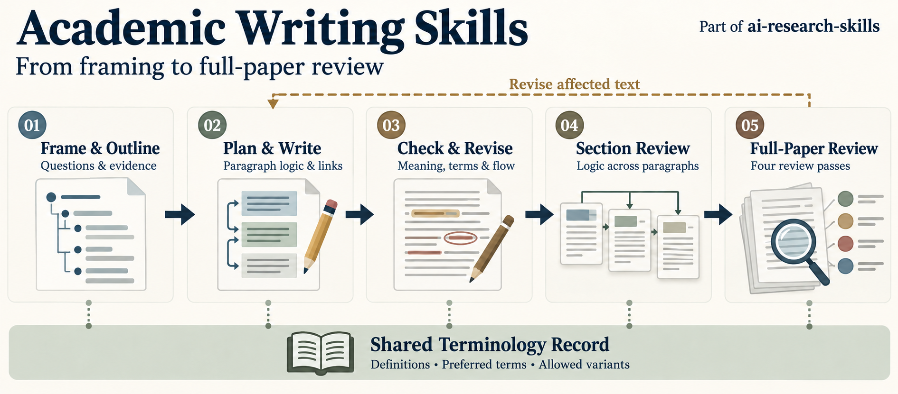
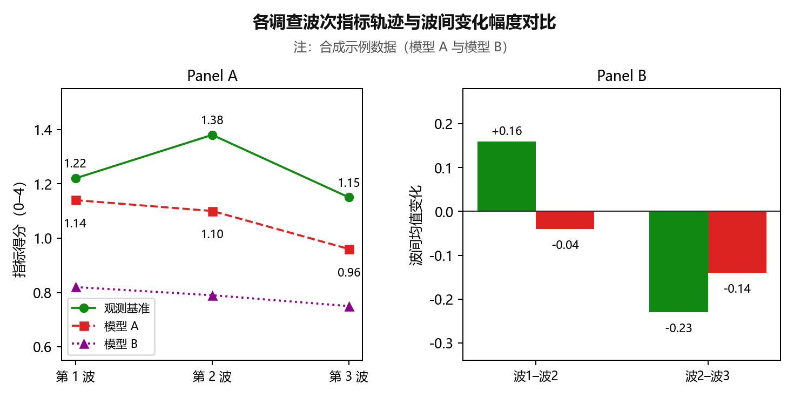
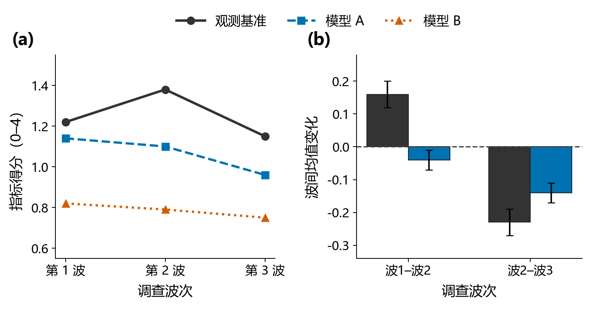
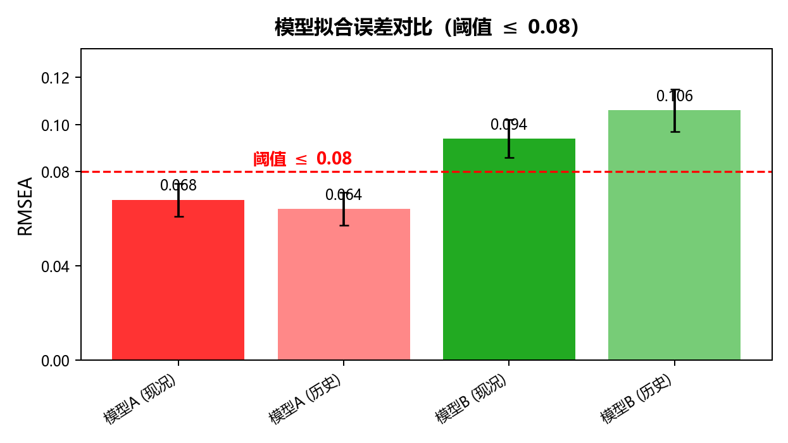
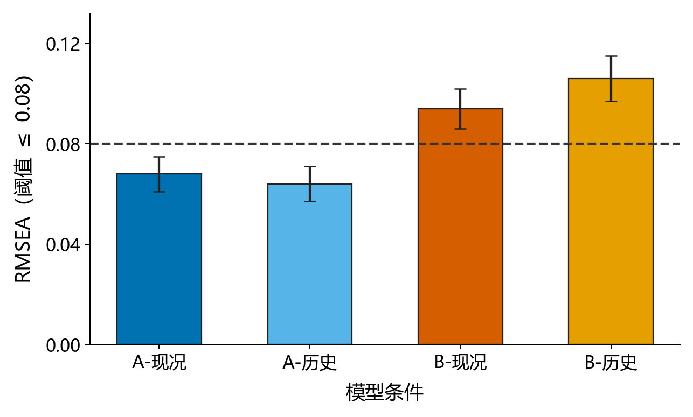
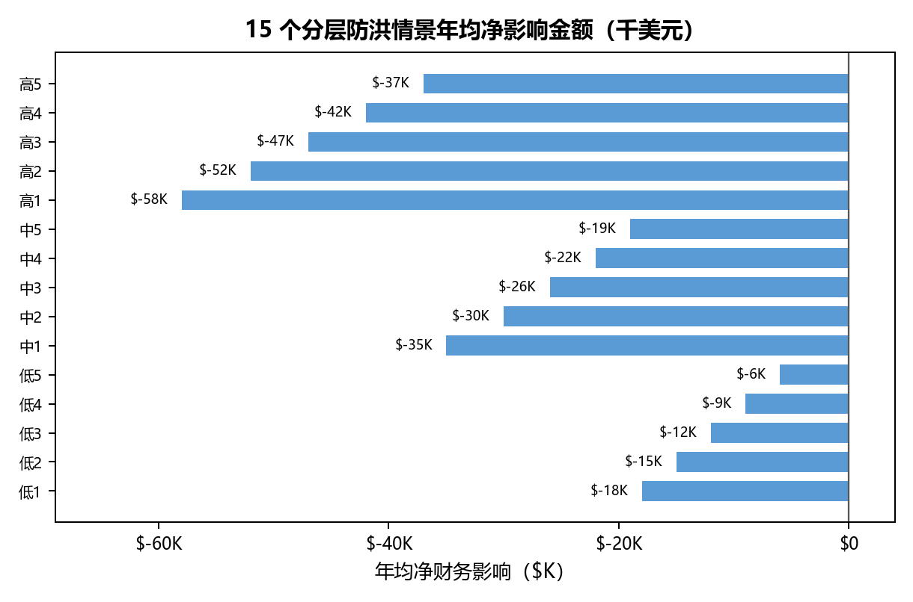
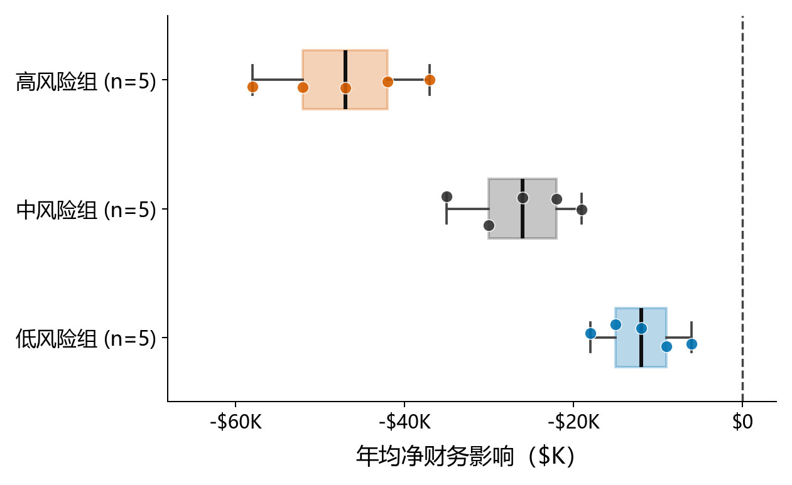
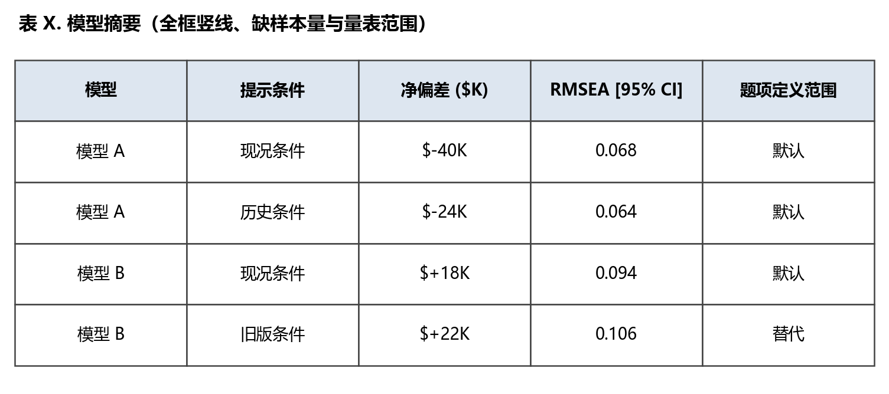
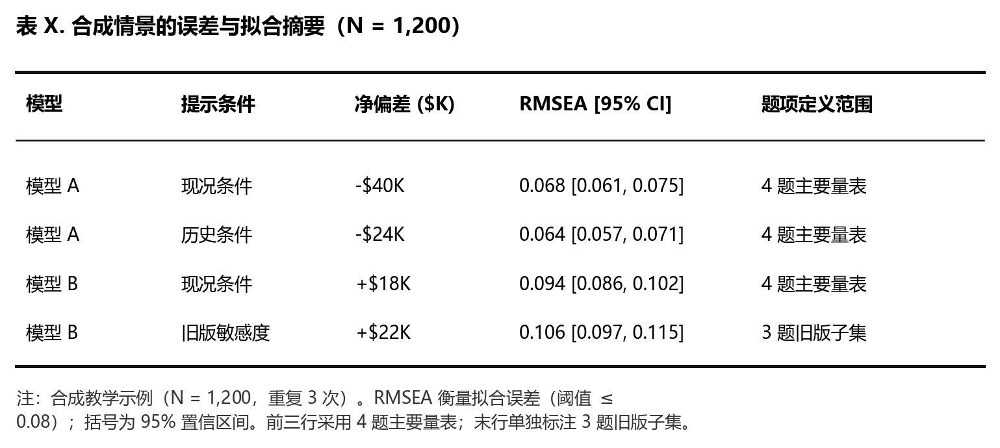

# Academic Writing Skills

[](./CHANGELOG.md)
[](./LICENSE)

本项目是 [ai-research-skills](https://github.com/WenyuChiou/ai-research-skills) 的一部分。

从大纲到修回文件，协助建立研究论证、连贯地逐段撰写，并核对目前证据能支持哪些主张。

可搭配 **Codex**、**Claude Code**、**OpenCode**、**Hermes Agent**，以及其他支援 Agent Skills 格式的 AI agents 使用。可用工具与整合功能依 host 而定。

[English](./README.md) | [繁體中文](./README.zh-TW.md) | 简体中文



*封面插图由 ChatGPT 内建影像生成功能制作，为 PNG 点阵图。*

## 可以协助什么

一个 plugin 提供两种功能，各有英文、繁体中文与简体中文入口：

- [academic-writing-skills](./skills/academic-writing-skills/SKILL.md)：规划、撰写、修改，并同步稿件的相关变动。
- [paper-review](./skills/paper-review/SKILL.md)：审查稿件，列出有具体位置的问题；默认不直接修改文件。

| 功能 | English | 繁体中文 | 简体中文 |
|---|---|---|---|
| 规划、撰写与修改 | [academic-writing-skills](./skills/academic-writing-skills/SKILL.md) | [academic-writing-skills-zh-tw](./skills/academic-writing-skills-zh-tw/SKILL.md) | [academic-writing-skills-zh-cn](./skills/academic-writing-skills-zh-cn/SKILL.md) |
| 审查，默认不修改文件 | [paper-review](./skills/paper-review/SKILL.md) | [paper-review-zh-tw](./skills/paper-review-zh-tw/SKILL.md) | [paper-review-zh-cn](./skills/paper-review-zh-cn/SKILL.md) |

同一项任务选一种语言入口即可，不必同时载入三种版本。中文版翻译的是操作指引，
不会自动把英文论文改成中文；交付语言、已确认术语及修改范围仍依作者要求。
程式工具、schema 和用于英文写作的范例保留原文。
现有的英文词汇扫描不是中文文法检查器。
手动安装审查入口时，还需一并安装同语言的写作入口，作为审查的基础。

| 范围 | 提供什么 | 会收到什么 |
|---|---|---|
| 一个段落 | 目前文字、相关前后文／来源，以及要保留的措辞 | 范围内的修改建议或编辑、具体位置的检查结果与未解的证据需求 |
| 一个章节 | 目前目的／大纲、证据与各段功能 | 功能规划、连贯正文或范围内的审查，不直接重写整篇 |
| 全文或修回文件 | 明确的现行正文与相关 companion files | 四轮审查结果、受影响的跨档核对，以及明确标示的未核实事项 |

### 涵盖内容与指南选用

写作 skill 依请求与稿件选用相关指南；不必每次载入所有章节，也不用自行挑选技术模块。

| 工作 | 对应指南 |
|---|---|
| 研究定位、大纲、引言与研究背景 | [生命周期](./skills/academic-writing-skills-zh-cn/references/lifecycle-and-routing.md)及[引言／背景](./skills/academic-writing-skills-zh-cn/references/introduction-and-study-context.md) |
| 方法、资料与假设 | [方法与假设](./skills/academic-writing-skills-zh-cn/references/methods-and-assumptions.md) |
| 结果、讨论与研究限制 | [结果](./skills/academic-writing-skills-zh-cn/references/results-and-explanation.md)及[讨论／限制](./skills/academic-writing-skills-zh-cn/references/discussion-and-limitations.md) |
| 结论与摘要 | [研究身分、综整与浓缩](./skills/academic-writing-skills-zh-cn/references/conclusion-and-abstract.md) |
| 图、表、SM 与参考文献 | [图表／SM](./skills/academic-writing-skills-zh-cn/references/figures-tables-and-supplements.md)及[文字／引用](./skills/academic-writing-skills-zh-cn/references/prose-and-citation-editing.md) |
| Reviewer response 与修回对照 | [回复流程](./skills/academic-writing-skills-zh-cn/references/reviewer-response-workflow.md) |

## 从研究架构到最终投稿

从架构发想厘清研究定位与大纲，再规划与撰写连贯的段落，并分清楚研究目标和用来完成目标的方法。检查与修改针对实际文字，不只看规划或字词扫描；章节审查再确认各段是否形成连贯论证。依 comment 修订时，分别确认文字已改好，以及原本的疑问是否已回答。

整篇审查会从头到尾进行四轮：**论证与结构、证据与主张范围、学术表达、交付完整性**。由上而下核对问题到证据，也由下而上确认证据能否支持结论；发现重大问题时，回查受影响的章节。

**共用词汇纪录贯穿全程。** 持续撰写同一篇论文时，沿用其定义、固定用词与允许变体。写前读取已确认的用词，确认修改后再更新纪录；新提议的名称须与作者已确认的选择分开。

检查深度依任务调整。单句文法修改不会启动所有阶段，也不要求建立新的管理文件。跨文件的修改则需回查受影响的摘要、文献与补充材料。

## 安装与使用

**安装版本：** 这份源代码已含四个中文入口。marketplace 跟踪 `main`，更新后请确认实际安装的 plugin 版本。
GitHub release、catalog 版本信息与本地 cache 分别更新。
手动安装时，请复制选定的 skill 文件夹到 host 支持的位置，并保留其中的 references、scripts 与 assets。

Claude Code 可透过 ai-research-skills marketplace 安装：

```bash
claude plugin marketplace add WenyuChiou/ai-research-skills
claude plugin install academic-writing-skills@ai-research-skills --scope user
```

更新指令：`claude plugin update academic-writing-skills@ai-research-skills`。

Codex 或 ChatGPT 可使用可用的 skill／plugin 介面。其他 Agent Skills clients 可将 `skills/` 下选定功能与语言的资料夹放入支援的位置：OpenCode 使用 `.agents/skills/` 或 `.opencode/skills/`，Hermes Agent 使用 `~/.hermes/skills/`。

## 直接试用

附上目前要处理的文字与来源；图表、补充材料、审查意见或期刊指引只在相关时提供。用一般文字指定 skill 名称即可。

### 研究定位与大纲

```text
请使用 academic-writing-skills-zh-cn skill，厘清这篇论文的研究定位并建立 extended outline。
确认研究缺口、问题、证据，以及每段的功能。
暂时不要撰写正文。
```

### 规划与逐段撰写

```text
请使用 academic-writing-skills-zh-cn skill，先规划这一节，再逐段撰写。
每段写之前，先说明重点、证据、推论界线，以及与前后文的关系。
写完后，复查意思、术语与连贯性。
```

### 修改一个段落

```text
请使用 academic-writing-skills-zh-cn skill，只修改这个段落。
需要时参照提供的引言／大纲，保留研究目标、比较关系与适用范围。
保留清楚的作者原句及已确立的专业用词。
检查实际修改后的意思与连贯性；缺少的证据请指出。
```

### 审查整篇论文

```text
请使用 paper-review-zh-cn skill，对正文与补充材料进行四轮审查：
论证与结构、证据与主张范围、学术表达、交付完整性。
定位各项问题，说明依据及影响，先不要修改文件。
```

### 对齐 reviewer response

```text
请使用 academic-writing-skills-zh-cn skill，将 response 与最新正文及补充材料对齐。
保留作者已写好且正确的句子，指出未达成的承诺与无法核实的交叉引用。
只有相关文件确实支持时，才能说某项修改已完成。
```

## 修改前与修改后对照

以下以**简体中文合成教学示例**（使用大语言模型辅助分析社区防洪适应问卷并投稿水资源期刊）展示实际差异：

### 段落改写对照（典型不好的 AI 中文段落 → 修订后学术段落）

**修改前（常见 AI 八股腔、未解术语与过度推论）：**

> 在当今快速发展的气候韧性与智慧水利时代背景下，大语言模型正发挥着至关重要的核心作用——不仅深入挖掘了家庭投保决策的内在机理，更为流域治理赋能了全新的研究范式。此外，目前尚无任何水文学研究探索过零样本随机角色提示词条件化。超越传统问卷调查的局限，本研究合成智能体取得了 0.04 的优异误差表现，这进一步凸显了人工智能的巨大潜力；总而言之，合成受访者已精准复现人类真实适应行为，完全可以替代高成本的长期实地追踪调查。

**修改后（经 `academic-writing-skills-zh-cn` ＋ `paper-review-zh-cn` 修订后）：**

> 尽管多波次家庭问卷能够追踪强降雨事件后的防洪投保变化，但在快速演变的洪泛社区反复开展抽样调查仍面临较高成本。既有的行为水文智能体模型依托问卷回归将家庭特征与群体投保趋势相联系，但受限于预设方程形式；另一种探索路径则是引入零样本大语言模型（LLM——无需重训模型参数、仅依据去标识化家庭档案生成问卷评分的通用文本模型）。本研究基于两波暴雨调查样本（*N* = 840），检验本地部署模型在“增补前期经历提示条件”下的模拟表现（该条件亦同步增加了输入提示词长度）。在该提示条件下，第 2 波群体均值误差达到 0.04（0–1 比例尺度），但家庭个体跨波变化的平均绝对误差仍高于假设相邻波次保持不变的“零变化基线规则”，表明现阶段其仅可作为辅助探索工具，尚不能替代概率抽样实地调查。

- **使用前后的核心差异：**（1）清除“在当今快速发展…发挥至关重要的作用…赋能全新范式…总而言之”等空洞 AI 套话与冗长破折号；（2）起草前先输出蓝图等待确认，保持水资源学科语境并在首次出现“零样本 LLM”与“零变化基线规则”时即给出白话功能解释；（3）用既有回归智能体先例取代缺乏实证依据的“尚无任何研究”，同时保留提示词变长的复合条件边界；（4）严谨区分县级群体均值拟合与个体轨迹误差。完整草稿前蓝图见[完整使用指南](./docs/USER_GUIDE.zh-CN.md#before-and-after-walkthrough)。

### 四张代表性科学图表修改前后示例

| 修改前（Before） | 修改后（After） |
|---|---|
| **1. 多子图：** 图内标题、内置图例与数值杂讯<br> | **1. 多子图 `(a)` `(b)`：** 标题移入图注、图外共用图例与色盲友好盘<br> |
| **2. 误差阈值图：** 柱顶撞误差线与 `0.08`/`0.10` 刻度重叠<br> | **2. 误差阈值图：** `0.08` 专属阈值刻度与坐标轴注释<br> |
| **3. >10 个分组情景：** 拥挤 15 条柱状图与 `$-40K` 笔误<br> | **3. >10 个已分组情景：** 箱线＋抖动散点与 `-$40K`（未分组时改点图）<br> |
| **4. 数据表：** 全框竖线、`$-40K`、缺 `N` 与区间范围<br> | **4. 学术三线表：** 明确 `N`、`95% CI` 与新旧题项注释（`booktabs`／Word）<br> |

同步支持 **LaTeX**（`.tex`／`.bib`、`booktabs` 与矢量 `.pdf` 图档）、**Word**（`.docx` OOXML 三线表与修订追踪）及 **Markdown** 交付输出。

## 适用界线与进一步说明

审查模块依研究内容选用，包含方程式、psychometrics／SEM、AI／LLM、水资源与洪水模型。这些 skills 协助来源核对及作者判断，不取代它们；缺少的结果或来源保持未核实，不自行编造。

- [完整使用指南](./docs/USER_GUIDE.zh-CN.md)：输入资料、更多 prompts、审查阶段与项目纪录。
- [图表实例](./skills/academic-writing-skills-zh-cn/references/figures-tables-and-supplements.md)：图、caption、表格与补充材料。
- [期刊与引用准则](./skills/academic-writing-skills-zh-cn/references/overlay-contract.md)。
- [版本纪录](./CHANGELOG.md)。

## 授权

[MIT](./LICENSE)
