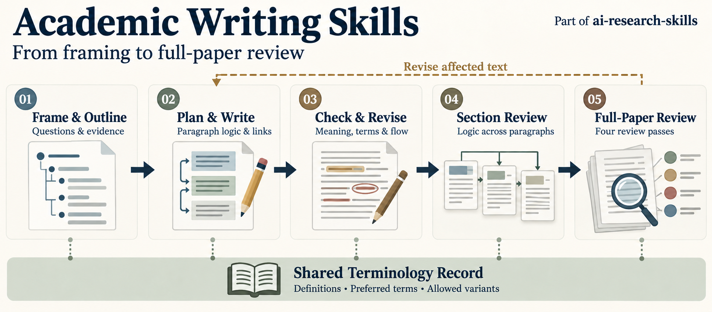

# Academic Writing Skills

[](./CHANGELOG.md)
[](./LICENSE)

本專案是 [ai-research-skills](https://github.com/WenyuChiou/ai-research-skills) 的一部分。

從大綱到修回文件，協助建立研究論證、連貫地逐段撰寫，並核對目前證據能支持哪些主張。

可搭配 **Codex**、**Claude Code**、**OpenCode**、**Hermes Agent**，以及其他支援 Agent Skills 格式的 AI agents 使用。可用工具與整合功能依 host 而定。

[English](./README.md) | 繁體中文 | [简体中文](./README.zh-CN.md)



*封面插圖由 ChatGPT 內建影像生成功能製作，為 PNG 點陣圖。*

## 可以協助什麼

一個 plugin 提供兩種功能，各有英文、繁體中文與簡體中文入口：

- [academic-writing-skills](./skills/academic-writing-skills/SKILL.md)：規劃、撰寫、修改，並同步稿件的相關變動。
- [paper-review](./skills/paper-review/SKILL.md)：審查稿件，列出有具體位置的問題；預設不直接修改檔案。

| 功能 | English | 繁體中文 | 简体中文 |
|---|---|---|---|
| 規劃、撰寫與修改 | [academic-writing-skills](./skills/academic-writing-skills/SKILL.md) | [academic-writing-skills-zh-tw](./skills/academic-writing-skills-zh-tw/SKILL.md) | [academic-writing-skills-zh-cn](./skills/academic-writing-skills-zh-cn/SKILL.md) |
| 審查，預設不修改檔案 | [paper-review](./skills/paper-review/SKILL.md) | [paper-review-zh-tw](./skills/paper-review-zh-tw/SKILL.md) | [paper-review-zh-cn](./skills/paper-review-zh-cn/SKILL.md) |

同一項任務選一種語言入口即可，不必同時載入三種版本。中文版翻譯的是操作指引，
不會自動把英文論文改成中文；交付語言、已確認術語及修改範圍仍依作者要求。
程式工具、schema 和用於英文寫作的範例保留原文。
現有的英文詞彙掃描不是中文文法檢查器。
手動安裝審查入口時，還需一併安裝同語言的寫作入口，作為審查的基礎。

| 範圍 | 提供什麼 | 會收到什麼 |
|---|---|---|
| 一個段落 | 目前文字、相關前後文／來源，以及要保留的措辭 | 範圍內的修改建議或編輯、具體位置的檢查結果與未解的證據需求 |
| 一個章節 | 目前目的／大綱、證據與各段功能 | 功能規劃、連貫正文或範圍內的審查，不直接重寫整篇 |
| 全文或修回文件 | 明確的現行正文與相關 companion files | 四輪審查結果、受影響的跨檔核對，以及明確標示的未核實事項 |

### 涵蓋內容與指南選用

寫作 skill 依請求與稿件選用相關指南；不必每次載入所有章節，也不用自行挑選技術模組。

| 工作 | 對應指南 |
|---|---|
| 研究定位、大綱、引言與研究背景 | [生命週期](./skills/academic-writing-skills-zh-tw/references/lifecycle-and-routing.md)及[引言／背景](./skills/academic-writing-skills-zh-tw/references/introduction-and-study-context.md) |
| 方法、資料與假設 | [方法與假設](./skills/academic-writing-skills-zh-tw/references/methods-and-assumptions.md) |
| 結果、討論與研究限制 | [結果](./skills/academic-writing-skills-zh-tw/references/results-and-explanation.md)及[討論／限制](./skills/academic-writing-skills-zh-tw/references/discussion-and-limitations.md) |
| 結論與摘要 | [研究身分、綜整與濃縮](./skills/academic-writing-skills-zh-tw/references/conclusion-and-abstract.md) |
| 圖、表、SM 與參考文獻 | [圖表／SM](./skills/academic-writing-skills-zh-tw/references/figures-tables-and-supplements.md)及[文字／引用](./skills/academic-writing-skills-zh-tw/references/prose-and-citation-editing.md) |
| Reviewer response 與修回對照 | [回覆流程](./skills/academic-writing-skills-zh-tw/references/reviewer-response-workflow.md) |

## 從研究架構到最終投稿

從架構發想釐清研究定位與大綱，再規劃與撰寫連貫的段落，並分清楚研究目標和用來完成目標的方法。檢查與修改針對實際文字，不只看規劃或字詞掃描；章節審查再確認各段是否形成連貫論證。依 comment 修訂時，分別確認文字已改好，以及原本的疑問是否已回答。

整篇審查會從頭到尾進行四輪：**論證與結構、證據與主張範圍、學術表達、交付完整性**。由上而下核對問題到證據，也由下而上確認證據能否支持結論；發現重大問題時，回查受影響的章節。

**共用詞彙紀錄貫穿全程。** 持續撰寫同一篇論文時，沿用其定義、固定用詞與允許變體。寫前讀取已確認的用詞，確認修改後再更新紀錄；新提議的名稱須與作者已確認的選擇分開。

檢查深度依任務調整。單句文法修改不會啟動所有階段，也不要求建立新的管理檔案。跨檔案的修改則需回查受影響的摘要、文獻與補充資料。

## 安裝與使用

**安裝版本：** 這份原始碼已含四個中文入口。marketplace 追蹤 `main`，更新後請確認實際安裝的 plugin 版本。
GitHub release、catalog 版本資訊與本機 cache 分別更新。
手動安裝時，請複製選定的 skill 資料夾到 host 支援的位置，並保留其中的 references、scripts 與 assets。

Claude Code 可透過 ai-research-skills marketplace 安裝：

```bash
claude plugin marketplace add WenyuChiou/ai-research-skills
claude plugin install academic-writing-skills@ai-research-skills --scope user
```

更新指令：`claude plugin update academic-writing-skills@ai-research-skills`。

Codex 或 ChatGPT 可使用可用的 skill／plugin 介面。其他 Agent Skills clients 可將 `skills/` 下選定功能與語言的資料夾放入支援的位置：OpenCode 使用 `.agents/skills/` 或 `.opencode/skills/`，Hermes Agent 使用 `~/.hermes/skills/`。

## 直接試用

附上目前要處理的文字與來源；圖表、補充資料、審查意見或期刊指引只在相關時提供。用一般文字指定 skill 名稱即可。

### 研究定位與大綱

```text
請使用 academic-writing-skills-zh-tw skill，釐清這篇論文的研究定位並建立 extended outline。
確認研究缺口、問題、證據，以及每段的功能。
暫時不要撰寫正文。
```

### 規劃與逐段撰寫

```text
請使用 academic-writing-skills-zh-tw skill，先規劃這一節，再逐段撰寫。
每段寫之前，先說明重點、證據、推論界線，以及與前後文的關係。
寫完後，複查意思、術語與連貫性。
```

### 修改一個段落

```text
請使用 academic-writing-skills-zh-tw skill，只修改這個段落。
需要時參照提供的引言／大綱，保留研究目標、比較關係與適用範圍。
保留清楚的作者原句及已確立的專業用詞。
檢查實際修改後的意思與連貫性；缺少的證據請指出。
```

### 審查整篇論文

```text
請使用 paper-review-zh-tw skill，對正文與補充資料進行四輪審查：
論證與結構、證據與主張範圍、學術表達、交付完整性。
定位各項問題，說明依據及影響，先不要修改檔案。
```

### 對齊 reviewer response

```text
請使用 academic-writing-skills-zh-tw skill，將 response 與最新正文及補充資料對齊。
保留作者已寫好且正確的句子，指出未達成的承諾與無法核實的交叉引用。
只有相關檔案確實支持時，才能說某項修改已完成。
```

## 適用界線與進一步說明

審查模組依研究內容選用，包含方程式、psychometrics／SEM、AI／LLM、水資源與洪水模型。這些 skills 協助來源核對及作者判斷，不取代它們；缺少的結果或來源保持未核實，不自行編造。

- [完整使用指南](./docs/USER_GUIDE.zh-TW.md)：輸入資料、更多 prompts、審查階段與專案紀錄。
- [圖表實例](./skills/academic-writing-skills-zh-tw/references/figures-tables-and-supplements.md)：圖、caption、表格與補充資料。
- [期刊與引用準則](./skills/academic-writing-skills-zh-tw/references/overlay-contract.md)。
- [版本紀錄](./CHANGELOG.md)。

## 授權

[MIT](./LICENSE)
