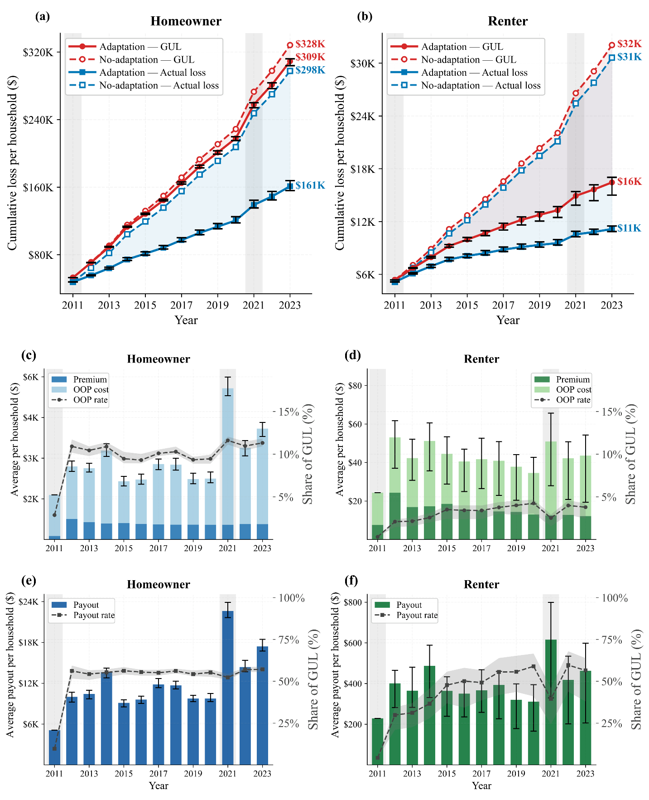
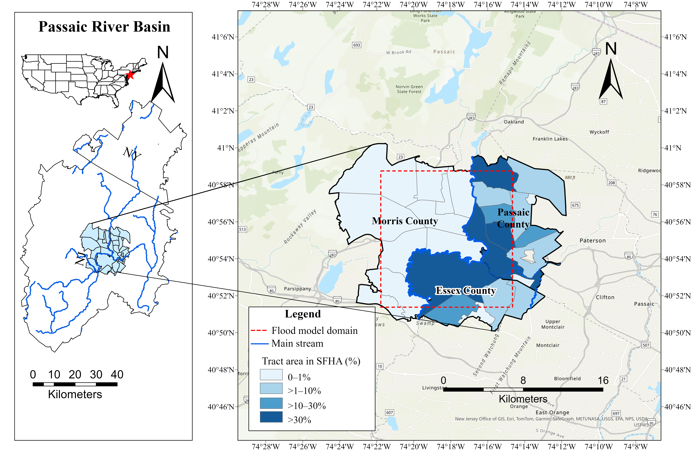

# 圖、表、圖表說明與補充資料

## 目錄

1. 讀者功能與最終尺寸清晰度
2. 圖表說明與表格附註
3. 同步與 SM
4. 專案格式與符號慣例
5. 實作 ABM 範例
6. 地圖、邊框與格線

## 讀者功能與最終尺寸清晰度

為每個圖表呈現賦予明確的主要分析目的。唯有當視覺化能比純文字更容易理解其關係時，才選用視覺圖表。檢查其標題、證據、子圖與周圍文本是否切合該目的；使用 [results-and-explanation.md](results-and-explanation.md) 進行研究問題對齊，無須僵化套用一對一規則。

應依據實際的數量、座標軸與比較內容來挑選圖表，而非憑藉檔名或吸引人的參考版面。例如，一張名為 `time-series.png` 的假設性圖片，若橫軸為結果變數，並帶有特定產業的密度曲線，所呈現的是分布情況而非隨時間的變化。它或許可為分布比較提供資訊，但無法確立時間趨勢。同樣地，沿經度的累積曲線無法識別各位置的數值，而二維顏色圖例則需要解釋所映射的兩個變數。唯有當編碼方式的數量與讀者功能契合時才予以沿用；切勿從螢幕截圖推斷缺失的單位、分母或資料來源出處。

應在實際的最終呈現尺寸下檢視渲染後的圖表呈現，包括其在文件中的配置位置。查核標籤、圖例、座標軸、單位、線條、標記、類別、註記與表格項目是否清晰易讀。檢查裁切、重疊、數值被遮擋、誤導性的顏色解讀，以及在可能觀看條件下的可區分度。高解析度的原始圖檔並非嵌入圖尺寸過小時仍具備可讀性的證據。

減少繪圖周圍或子圖之間無功能的留白，同時保留有用的區隔、比例與呼吸空間。切勿填滿每個空白區域、將圖例擠壓在證據之上、拉伸長寬比、無正當理由更動比較比例，或裁切必要的註記以使圖形看起來更大。若有已核實的發表管道規範，請依規範執行；切勿憑空捏造通用的字型大小或頁面填滿目標。

調整文字大小後，應將圖例與註記一併檢查。較大的圖例絕不可遮蔽數值或截斷標籤。對於地圖，請保留有意義的地理背景、清晰的比例尺、類別定義與清晰可辨的地名標籤。面積百分比並非人口百分比。若無法檢視實際版面，應回報該限制，而非草率認證該視覺圖表清晰可讀。

## 圖表說明與表格附註

請使用簡明的描述性圖表標題，隨後提供獨立閱讀該圖所需之必要資訊：組別、情境或基準、相關期間、子圖配置、顏色或線型、單位與正規化方式、摘要統計量、必要時的樣本／執行次數，以及不確定性定義。避免逐一敘述所有結果或重複正文內容。在「方法」中定義不確定性慣例可減少重複，但圖表說明中仍應保留足夠資訊，以避免色帶或誤差線產生歧義。

請使用簡明的表格標題。將緊湊的閱讀資訊置於表格附註中：解讀項目所需的基準、單位、分母、統計量、不確定性、正負號以及設計條件。實驗的科學理由及其實質解讀應保留在正文散文中，而非僅寫在附註裡。對於 SM 中的敏感度圖，請在圖表說明中解釋變更的因子與比較設計；對於敏感度表格，請利用附註說明對應項目的閱讀細節，無須額外添加冗餘的結果論述。

在讀者必須解讀符號之前，務必釐清其意涵。正規方程式後接 `where` 子句即可定義其符號；請避免在先前的正文中出現仰賴未定義符號的敘述。應說明專門工具或機構的作用，而非僅展開其首字母縮寫。視需要於獨立閱讀邊界處定義縮寫，切勿機械式地在每一則圖表說明中重複定義。

## 同步與 SM

SM 應與「方法」及「結果」同步撰寫發展。將核心方法邏輯與主要問題的證據保留在稿件中；工具量表、推導過程、設定參數及延伸證據則置於 SM，並在正文中提供明確的正文指引。相關的正文表格與補充表格需要具備不同的讀者功能，而非重複列出完整項目。

### 具明確目的之補充資料引用

首次實質引用補充文本（Text）、表格（Table）或圖片（Figure）時，請清楚說明其功能：定義、準則、選定項目、詳細結果、執行摘要或診斷資訊。在描述其提供的內容前，請先查驗實際項目；相鄰的數字並非支持該主張的證據。一旦確立該功能後，後續只需簡短指引即可。在僅限審閱的任務中，除非具體的讀者問題確實需要修改，否則請保留清晰、正確的指引。

當能改善行文流暢度時，可將引用整合至句子中。例如，`The selected questions are listed in Table S11` 標明了內容，而準則陳述句末可接 `as described in Text S4`。相較於在主詞與動詞之間做不必要的插入，置於句末的自然引用更為理想。這些均為範例，並非固定字句，亦非對括號引註的全盤禁止。若作者偏好避免使用未經解釋的括號引用，請在該專案的處理範圍內遵循此偏好。

切勿為每個結果都添加獨立的導航句子、機械式列出每一項相關補充項目，或在每次提及时重複該項目的完整用途。應將指引與其實際支持的證據放在一起，維持主要結果與比較的顯著地位。請區分所呈現的單次執行與多次執行的摘要，並區分受訪者之間的變異與執行層級統計量之間的變異；跨執行的摘要並不會讓單次執行的顯著性檢定適用於每一次執行。

請遵循現行的編號慣例，並依各自功能核對分組引用。若敘事順序與規定的引用順序發生衝突，請標記該編號相依性，切勿僅為了維持數字順序而將不相關的表格附會於某項結果。

對於已接受／已投稿的修訂版，除非因結果改變、承諾補充、已核實的錯誤或必要的相依性而必須修改，否則請保留運作正常之原始 SM 的用字與組織架構。若被置換的內容仍有需要，應予以移動而非默默捨棄。切勿僅為了讓未更動的補充資料看起來像是經過修改而添加評述。

在重新排序、移除、合併或拆分項目後，應對齊正文引註、子圖字母編號、文件內圖表說明、最終圖表清單、SM 目錄、附註以及回覆引註。請依據其功能檢查每個舊引用；切勿盲目替換舊項目編號，因為它現在可能指向其他內容。使回報的數據與底層輸出及已儲存的最終圖檔保持一致。依專案約定的儲存慣例，保留可編輯的來源與直接的重現性相依項目。

請使用生效的修訂文本檢查乾淨版本與修訂記錄版本，排除已刪除或移出的文字。使用適當的文件技能檢查保留的註解、作者資訊、功能變數、圖片位置、表格分頁以及殘留的空白物件。XML 檢查不能取代對渲染後版面的檢視。

## 專案格式與符號慣例

請將粗體引註、範圍連接號、標題大小寫、圖表說明順序及縮寫偏好視為專案或發表管道的慣例，而非通用的期刊規則。請記錄現行慣例，並一致地套用於選定的產物中。

例如，某專案可能偏好使用 **Figures S4** to **S6**，將引用標號設為粗體而 `to` 保持純文字，或者對單一圖片使用 **Figure 7**。此為可重複使用的格式範例，並非每篇論文的強制要求。單複數形式應與實際引用的項目數量相符。應一致地更新標題標籤與最終清單，而非將整份文件全部加粗。

在圖表說明、表格、方程式與正文中，請維持單位、分母與數量名稱的一致性。即使同樣以百分比為單位，正規化差異／GUL 百分比與正規化差異／所得百分比仍是截然不同的指標。座標軸標籤應標示繪製的數量，而非如兩條曲線間的邊際差額等註記。使用穩定的專業術語，並在關鍵處釐清絕對差異、相對變化以及百分點差異。

## 實作 ABM 範例

請利用這些作者要求的範例來理解圖表呈現功能，切勿將此模型的具體事實套用到其他論文中。來源為 `ABM_manuscript_20260812_WC_clean_label.docx`（SHA-256 `5464b65aa813777fe00fe90bd41255b7be07b842487ee13db42bd4b9815c5176`）。其生效文本不包含追蹤修訂節點。下方保留了原始表格與圖表說明的文字；合併的 FI 標籤在 Markdown 中重複呈現。圖片經擷取未作更動。教學註記乃另行提供，並不修改稿件。

### 原始表格 1

**Table 1.** Stochastic adoption threshold bounds by action, household group, and SFHA status.

| Action | Household group | Bounds [lₐ, hₐ] | Rationale | Sources |
|---|---|---|---|---|
| FI | Homeowner inside SFHA | [0.00, 0.10] | Homeowners inside the SFHA may face insurance purchase requirements linked to federally backed mortgages. | FEMA (2025b); Kousky (2018) |
| FI | Homeowner outside SFHA | [0.35, 0.55] | Homeowners outside the SFHA generally purchase FI voluntarily. | Browne & Hoyt (2000); Kousky (2018) |
| FI | Renter | [0.70, 0.90] | Renters generally have lower FI adoption and are not subject to mortgage-linked purchase requirements. | Koller (2025); Kousky (2018) |
| EH | Homeowner | [0.30, 0.60] | Elevating a house requires upfront cost and structural work. | Aerts et al. (2018); FEMA (2014) |
| BP | Homeowner | [0.25, 0.65] | Participation depends on available funding, eligibility, and government approval. | Curran-Groome et al. (2022); Greer & Brokopp Binder (2017) |
| RL | Renter | [0.30, 0.95] | Moving depends on costs, housing availability, employment, and social ties. | Bukvic & Owen (2017); Lee & Van Zandt (2019) |

### 教學附註（此處新增，非稿件內容）

來源表格 1 並無獨立附註；其操作說明位於第 3.2.2 節。以下附註示範如何使該表格具備獨立可讀性：

> **Note.** FI, flood insurance; EH, house elevation; BP, buyout program; RL, relocation; SFHA, Special Flood Hazard Area. The bounds specify dimensionless intervals for uniformly drawn adoption thresholds, not empirically estimated confidence intervals or observed adoption rates. An action is adopted when its predicted probability exceeds the threshold. Lower thresholds therefore make adoption easier at the same predicted probability. The intervals are model assumptions informed by the listed rationales, not estimates from the survey regression. They do not measure household income or establish affordability.

體察功能的劃分：

- **標題：** 標明製表內容以及哪些群體／狀態區分至關重要。
- **欄位：** 將行動、母體、數值設定、基本原理與引用的背景資訊明確區隔，而非將其隱藏在冗長的單一圖表說明中。
- **附註：** 解釋如何解讀數值，並防止將閾值誤認為百分比、不確定性區間或測得的比率。
- **方法：** 保留具有深遠影響的緣由、操作性決策規則與假設；簡要的附註並不能取代該說明。

來源引用重現了情境性的基本原理；它們並未證實這些確切的界限。此實作範例並未對引用的論文進行獨立查核。對於不同的研究，請區分支持質性基本原理的證據與估算數值參數的證據，且僅納入相關的欄位與附註細節。

### 原始圖片 6

> **Figure 6.** Flood losses and financial outcomes per household for homeowners (left) and renters (right) from 2011 to 2023. Panels (a) and (b) compare cumulative GUL (red) and actual loss (blue) under the adaptation scenario (solid) and the no-adaptation baseline (dashed). Under the adaptation scenario, panels (c) and (d) show annual premiums, OOP costs, and OOP rates, while panels (e) and (f) show annual insurance payouts and payout rates. Lines and bars show medians across 50 simulation runs, and black error bars indicate the IQR. Gray shading marks major flood years (2011 and 2021).

### 解讀圖表說明設計

此處 GUL 代表保險賠付前的總損失（ground-up loss），OOP 代表自付費用（out-of-pocket），IQR 則代表四分位距（interquartile range）。這些解釋屬於教學註記；稿件在其他處定義其術語。

- **開頭：** 在描述各子圖之前，先指明結果變數、比較單位、兩個群體、空間配置以及期間。
- **子圖對照配置：** 將 (a)/(b) 中的累積情境比較與 (c)/(d) 及 (e)/(f) 中的年度財務組成成分區隔開來，使六個子圖的組織結構清晰易讀。
- **編碼方式：** 將顏色賦予損失數量，線型賦予情境。後續子圖僅限調適情境的處理範圍十分明確。
- **統計解讀：** 明確識別中位數、模擬執行次數與 IQR 誤差線，而非將所有圖表呈現皆稱為平均值，或將所有區間皆稱為信賴區間。
- **正文：** 解釋路徑對比及其對科學問題的回答。圖表說明提供的是閱讀指引，而非第二個「結果」段落。

保留此來源並非代表對版面配置或完整性的全面認證。在改寫圖表說明之前，應對照實際繪圖來源檢查其餘填滿區域與陰影色帶、核實比率分母，並檢查在最終嵌入尺寸下的可讀性。能夠閱讀此 PNG 檔並不代表認證其在 Word 文件中的位置配置。

切勿將該 ABM 的閾值、六子圖版面、50 次執行、年份、首字母縮寫或屋主／租屋者比較照搬至無關的研究中。應借鑒這些範例背後的決策：明確標示圖表呈現的目的、將資料與基本原理分開、解釋編碼方式與數值意涵，並在相關正文散文中保留有證據支持的解讀。

## 地圖、邊框與格線

請先套用現行的 [venue profile](overlay-contract.md)。切勿從熟悉的地圖風格、Markdown 表格或單篇已發表的文章推斷期刊要求。

### 地圖閱讀與空間意涵

識別地圖究竟是提供研究背景，還是回答分析性問題。清楚顯示相關位置、流域／行政邊界、分析領域以及抽樣／模型單元。當讀者需要地理方位定位時，嵌入插圖（inset）便很有用，而非強制作為裝飾。研究區域應維持足夠清晰可讀的大小，同時不刪除必要的背景資訊；在最終尺寸下，應將插圖、標籤、比例尺、圖例與主地圖一併檢查。

解釋所繪製的數量、單位、分母、參考期間與分級方式。顯示分級邊界時不得有重疊或未加說明的間隙；應區分有效的零值與缺失／無資料區域。對於具順序的大小數量，使用連續漸層色階（sequential scale）；對於圍繞有意義參考點的變化，使用具正當理由的發散色階（diverging scale）。對於雙變量地圖，應解釋兩個維度以及各顏色的解讀方式。較深的顏色或多邊形的大小皆不能證明家戶數量更多或存在因果效應。

在適當的圖表說明、「方法」或 SM 中，保留資料來源／版本／日期、與距離／面積相關的座標參考系統或投影法，以及底圖歸屬／授權。請從可編輯的 GIS／來源紀錄核實這些資訊；切勿從螢幕截圖推斷。縮放大小或重新投影後，比例尺與方位輔助標記必須維持有效；當指北針或座標標籤有助於辨別方位時可予以使用，而非作為自動要求的必備項目。比較多幅地圖時，應對齊涵蓋範圍、分級斷點、正規化方式與圖例語意，或對變更進行說明。局部的顏色變化不一定會推翻整個研究的結論，但必須更新其陳述的空間解讀。

### 原始 ABM 圖片 1

> **Figure 1.** The study area of this paper: the Passaic River Basin and the flood modeling domain with percentages of each census tract’s area within the Special Flood Hazard Area (SFHA).

**教學註記，非原始圖表說明內容：** 左圖標明流域位置；放大的右圖將虛線洪災模型領域與人口普查區（tract）多邊形及河流區分開來。四種由淺至深的藍色類別顯示位於 SFHA 內的人口普查區面積：0–1%、>1–10%、>10–30% 以及 >30%。這並非家戶百分比，亦非對個別 SFHA 狀態的直接觀察。表格／模型指派規則需要另外說明。比例尺與郡縣標籤為地理閱讀輔助工具之範例，並非每幅地圖皆須繼承的要求。

原始擷取的圖片與圖表說明均予保留。此 PNG 檔案無法確立座標參考系統、來源圖層年代、分級計算方式或比例尺的準確性。在改寫或認證地圖時，請從 GIS 紀錄中核實這些項目；本範例並非地理稽核或最終 Word 版面稽核。

### 表格格線與繪圖網格對比

請依據現行的發表管道／範本以及讀者所需的結構來挑選表格框線。請區分實際可列印的框線與不列印的 Word 格線。對於簡單表格，頂線／表頭線／底線的極簡模式往往已足夠；分組線或其他具無障礙特性的版面可能亦具正當理由。避免不必要的儲存格全框線，但切勿移除必要的邊界，亦勿將相同樣式強加於所有發表管道與複雜表格之上。

**觀察到的 ABM 表格 1 格式：** 直接 Word OOXML 指定了 **1 pt** 的頂部與底部水平橫線、表頭下方 **0.5 pt** 的橫線，且沒有左／右、內部垂直或內部列線。所有內部列均已檢查是否有覆蓋儲存格框線之情況。此為來源格式範例，並非通用的三線表要求或規定線寬。上方 Markdown 重現僅傳達表格項目，而非 Word 框線；檢視 OOXML 並不等同於檢視渲染後的表格、其分頁或重複表頭。

[AGU LaTeX submission guide dated January 2023](https://www.agu.org/-/media/Files/Publications/Latex_submission_guidelines_Jan162023.pdf) 不建議使用垂直表格線。那是特定發表管道／範本的來源，而非所有期刊皆要求這些 ABM 線寬的證明；請透過發表管道設定檔重新整理適用性。切勿在未查核當前指引的情況下，沿用較舊範本的其他規則。

對於繪圖，請將座標軸脊線（spines）、參考線與閱讀格線與表格框線區分開來。保留有助於讀取刻度或具備有意義基準線的線條；弱化與資料競爭視覺焦點的非必要格線。請依據繪圖功能與發表管道來決定頂部／右側脊線與刻度密度，而非採取一刀切的美學禁令。更動上述任何元素後，應重新檢查資料、標籤、不確定性以及最終尺寸清晰度。
